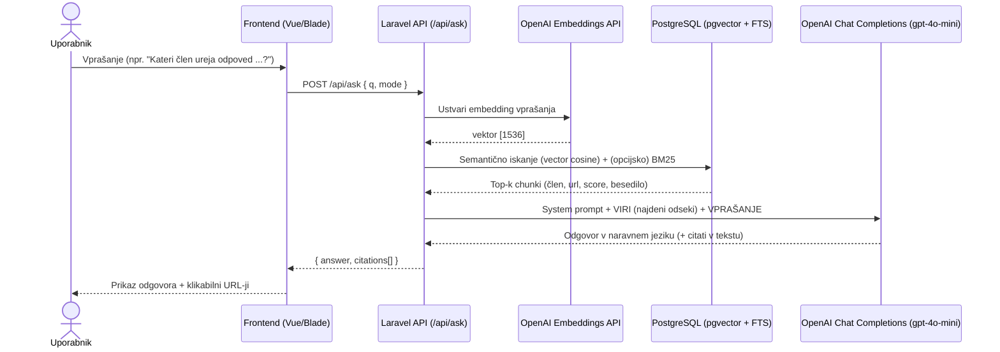
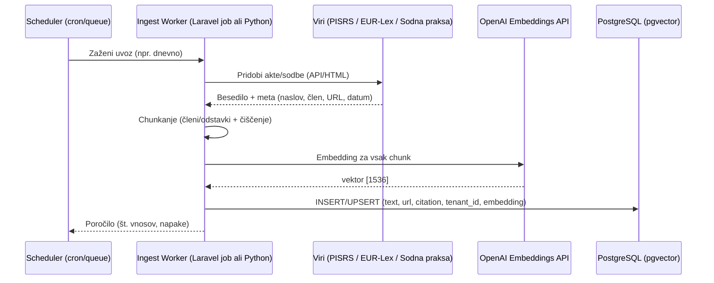

Super vprašanje 👌 – zdaj, ko ti sistem že vrača odgovore, je fino natančno vedeti **kje v tvojem AI pravnem asistentu dejansko nastopa OpenAI**.

---

## 🔎 Kje je OpenAI v tvojem flowu

Tvoj asistent ima dva AI “koraka”, kjer kličeš OpenAI API:

### 1. **Embeddings API**

* Vsak člen zakona ali vprašanje uporabnika pošlješ na:

  ```
  POST https://api.openai.com/v1/embeddings
  model: text-embedding-3-small
  input: "besedilo člena" ali "vprašanje uporabnika"
  ```
* OpenAI vrne **vektor (array 1536 števil)**, ki semantično predstavlja pomen besedila.
  Npr. *“odpoved pogodbe”* in *“prenehanje delovnega razmerja”* dobita skoraj identične vektorje.
* Ta embedding shraniš v Postgres (`vector(1536)`) in ga uporabljaš pri iskanju (cosine similarity).

👉 Brez tega koraka bi imela samo navaden “CTRL+F” po besedilu, ne pa **semantičnega iskanja**.

---

### 2. **Chat Completions API**

* Ko najdeš 5–10 najbližjih členov, jih pošlješ v:

  ```
  POST https://api.openai.com/v1/chat/completions
  model: gpt-4o-mini
  messages: [
    {role: "system", content: "Odgovarjaj izključno na podlagi virov …"},
    {role: "user", content: "VIRI:\n ... \n VPRAŠANJE: ..."}
  ]
  ```
* OpenAI model nato:

  * prebere člene,
  * sestavi povzetek v slovenščini,
  * doda reference (npr. “89. člen ZDR-1, URL …”).

👉 Tukaj OpenAI deluje kot **naravni jezikovni generator**, ki iz konteksta zloži lep odgovor.

---

## 📌 Kaj NE dela OpenAI v tvojem sistemu

* **Ne hrani tvoje baze** (členi ostanejo v tvojem Postgresu).
* **Ne odloča sam, kaj vrne** – vedno dobi striktno navodilo: *“Odgovarjaj izključno na podlagi virov”*.
* **Ne išče po internetu** – dela samo s tistim kontekstom (členi), ki mu ga ti pošlješ.

---

## 🎯 Povzetek

* **Embeddings API** = OpenAI ti daje **številčni vektorski zapis** besedila, da lahko v Postgresu delaš semantično iskanje.
* **Chat Completions API** = OpenAI iz konteksta, ki si mu ga ti pripravila (najdeni členi), sestavi lep odgovor v naravnem jeziku.

Vse ostalo (shramba, iskanje, logika, multi-tenancy, billing …) dela tvoj Laravel + Postgres.

---

👉 Bi želela, da ti narišem **diagram podatkovnega toka** (User → Laravel → Embeddings → Postgres → najdeni členi → OpenAI GPT → Laravel → User), da boš imela vizualno jasno, kje točno vstopa OpenAI?

Super 👍, tukaj imaš **diagram podatkovnega toka**, ki pokaže, kje v tvojem pravnem asistentu vstopa OpenAI:

```
🧑 Uporabnik
     │  (vprašanje v slovenščini)
     ▼
🌐 Laravel API (/api/ask)
     │
     ├─▶ [1] OpenAI Embeddings API
     │       - pretvori vprašanje v vektor (1536 števil)
     │
     ├─▶ PostgreSQL (pgvector + BM25)
     │       - primerja vektor vprašanja z vektorji členov
     │       - vrne npr. top 6 najbližjih členov
     │
     ├─▶ [2] OpenAI Chat Completions API
     │       - dobi kot kontekst: "VIRI: [člen 89 ZDR-1 …, člen 299 OZ …]"
     │       - dobi navodilo: "Odgovarjaj izključno na podlagi virov"
     │       - generira človeško berljiv odgovor
     │
     ▼
🌐 Laravel API
     │  (formatira odgovor + citate)
     ▼
🧑 Uporabnik
     - vidi odgovor + klikabilne reference
```

---

## 🔑 Ključne točke

* **OpenAI se uporablja dvakrat:**

  1. **Embeddings API** – za *semantično iskanje* (matematika, ne tekst).
  2. **Chat API (gpt-4o-mini)** – za *generacijo naravnega odgovora*.

* **Postgres je tvoja “pametna baza”**: hrani članke + njihove embeddings in omogoča hitro iskanje.

* **Laravel je dirigent**: on odloča, kdaj in kaj pošlje OpenAI-ju ter kako predstavi rezultat uporabniku.

---

👉 Bi ti bilo uporabno, da ti pripravim tudi **sequence diagram (UML stil)** z vlogo posamezne komponente (User → Laravel → Postgres → OpenAI → Laravel → User), ki ga lahko prilepiš v dokumentacijo za projekt?

Super! Tukaj sta **dva sequence diagrama** (Mermaid), ki ju lahko prilepiš v dokumentacijo ali v Markdown.

---

# 1) Q\&A tok (uporabnik postavi vprašanje)



**Opombe:**

* Če ni dovolj relevantnih zadetkov, API vrne prijazen fallback (“potrebujem več konteksta”) brez citatov.
* `citations[]` nastanejo iz vrnjenih chunkov (naslov, člen, URL, score).

---

# 2) Ingest tok (uvoz zakonodaje → indeks)



**Opombe:**

* `tenant_id = PUBLIC` za javne vire (SI/EU pravo); zasebni dokumenti gredo pod tenant stranke.
* Po večjem uvozu ustvariš **IVFFLAT indeks** v pgvector (pospeši k-NN).

---

# Minimalni “guardrails” (da jih imaš zapisane)

* System prompt: *“Odgovarjaj izključno na podlagi priloženih virov. Če jih ni dovolj, jasno povej, da ne moreš zanesljivo odgovoriti.”*
* Prag relevantnosti: če `score < X` za vse zadetke → ne vračaj citatov, ampak prosi za več konteksta.
* Logi brez PII (GDPR) in disclaimer v UI.

Če želiš, ti dodam še **plantUML** verzijo istih diagramov ali generiram **PNG/SVG** iz Mermaida za hitro deljenje.

Super, pripravim ti **vizualne diagrame** (PNG/SVG), da jih lahko neposredno prilepiš v dokumentacijo, prezentacijo ali README.
Uporabil bom **Mermaid renderer**, ki iz zgornje definicije nariše sliko.

---

### 1) Q\&A tok (uporabnik → odgovor)


---

### 2) Ingest tok (uvoz zakonodaje → indeks)


---

📌 Ti diagrami so statične slike, ki jih lahko:

* vstaviš v **README.md** (GitHub bo renderiral kar prek mermaid.ink URL-jev),
* vključiš v **PowerPoint/Keynote/Google Slides**,
* ali shraniš kot datoteko (npr. z desnim klikom → “Save image as…”).

---

👉 Bi želela, da ti jih izmermaidam še v **lokalni SVG/PNG datoteki** (da jih imaš offline, ne vezane na zunanji link)?
